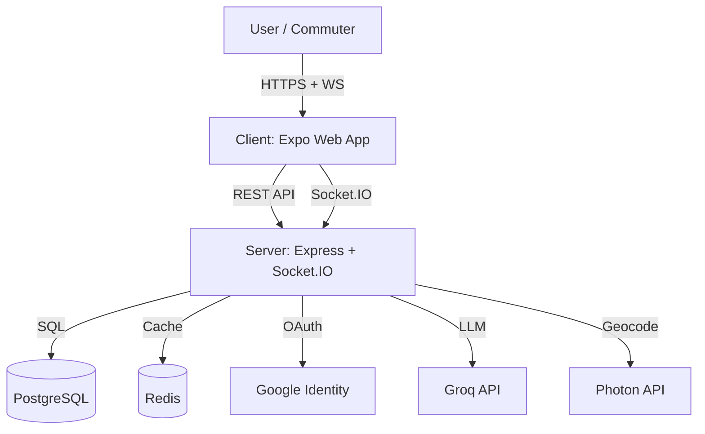
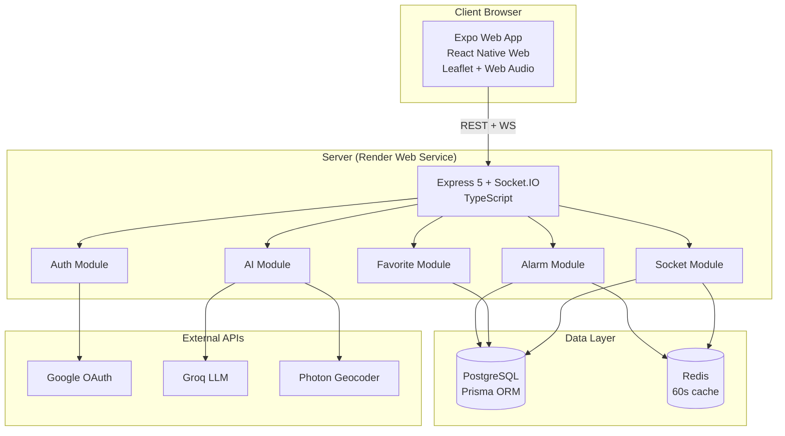
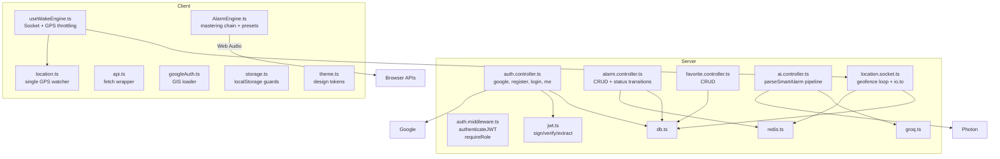
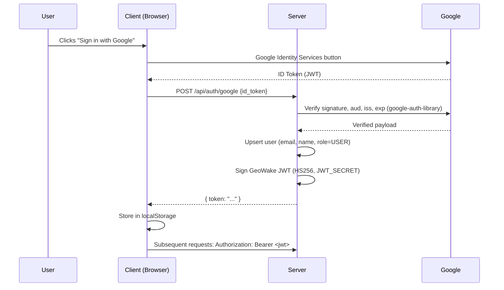
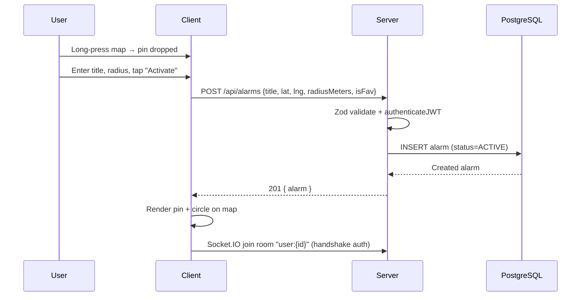
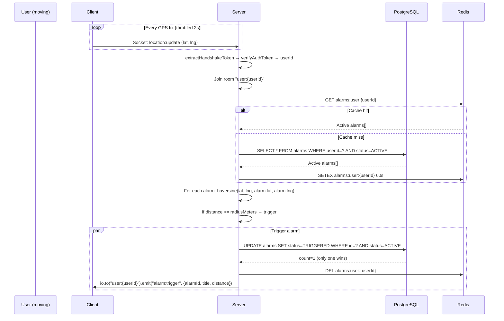
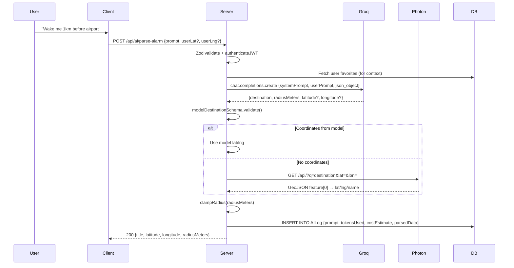
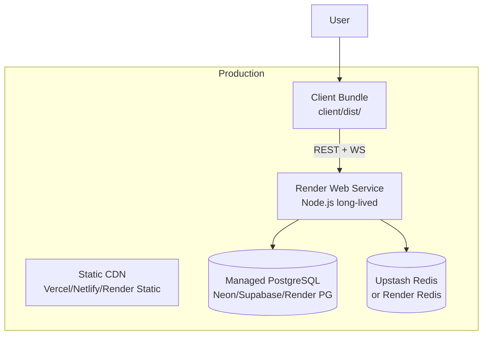

# High-Level Design (HLD)

## 1. System Context (C4 Level 1)

**Actors & Systems:**
| Actor/System | Role |
|--------------|------|
| **User** | Commuter, student, shift worker — interacts via browser |
| **Client** | Expo SDK 57 web app (React Native Web) — map, GPS, audio, settings |
| **Server** | Express 5 + Socket.IO — auth, alarms, favorites, AI, geofence |
| **PostgreSQL** | Primary data store (users, alarms, favorites, AI logs) |
| **Redis** | 60s alarm cache; fallback to PG on failure |
| **Google Identity** | OAuth 2.0 ID token verification |
| **Groq API** | LLM (llama-3.3-70b) for prompt → structured alarm |
| **Photon API** | Free geocoder (OpenStreetMap) for destination → lat/lng |

---

## 2. Container Diagram (C4 Level 2)

**Protocols:**
| Connection | Protocol | Purpose |
|------------|----------|---------|
| Client ↔ Server (REST) | HTTPS / JSON | CRUD for alarms, favorites, auth, AI |
| Client ↔ Server (WS) | Socket.IO (websocket + polling fallback) | Real-time location updates, alarm triggers |
| Server → PostgreSQL | TCP / Prisma | Persistent storage |
| Server → Redis | TCP | 60s alarm cache |
| Server → Google | HTTPS | ID token verification |
| Server → Groq | HTTPS | LLM completion (JSON mode) |
| Server → Photon | HTTPS | Geocoding (GeoJSON) |

---

## 3. Component Diagram (C4 Level 3)

---

## 4. Sequence Diagrams

### 4.1 Authentication (Google OAuth)

### 4.2 Create Alarm (REST + WebSocket)

### 4.3 GPS → Geofence Trigger (Core Loop)

### 4.4 AI Prompt Parsing (Groq + Photon)

---

## 5. Technology Stack & Rationale

| Layer | Technology | Rationale |
|-------|------------|-----------|
| **Language** | TypeScript 5+ | Type safety across stack |
| **Runtime** | Node.js 22+ | LTS, native fetch, Web Crypto |
| **Web Framework** | Express 5 | Modern, async middleware, no `x-powered-by` |
| **Real-time** | Socket.IO 4 | Auto-reconnect, rooms, binary support |
| **ORM** | Prisma Client | Type-safe DB, migrations, relation safety |
| **Database** | PostgreSQL 15 | Relational, JSONB for AI logs, geospatial queries |
| **Cache** | Redis 7 (ioredis) | 60s alarm cache, pub/sub ready |
| **Auth** | google-auth-library + jose | ID token verification, HS256 JWT |
| **Validation** | Zod | Schema-first, parse + safeParse |
| **Passwords** | bcrypt (cost 10) | Industry standard |
| **Client** | Expo SDK 57 (React Native Web) | Single codebase, web-optimized |
| **Map** | Leaflet 1.9 | Lightweight, no API key (OSM/Esri) |
| **Audio** | Web Audio API | Synthesis, scheduling, offline-capable |
| **Geolocation** | navigator.geolocation.watchPosition | High-accuracy, throttled |
| **Geocoding** | Photon (Komoot) | Free, OSM-based, no key |
| **LLM** | Groq (llama-3.3-70b-versatile) | Fast, JSON mode, low cost |
| **Styling** | Design tokens + StyleSheet | Consistent, themeable, a11y |

---

## 6. Security Architecture

| Concern | Implementation |
|---------|----------------|
| **Authentication** | JWT (HS256) signed with `JWT_SECRET` (≥32 chars). Same secret for HTTP middleware and Socket.IO handshake. |
| **Google OAuth** | Server verifies ID token via `google-auth-library` (RSA signature, aud, iss, exp). Never `jwt.decode()` without verification. |
| **Authorization** | `authenticateJWT` middleware extracts user from verified token. `requireRole("ADMIN")` middleware for admin routes. |
| **Ownership Scoping** | Every alarm/favorite query filtered by `userId` from token. `UPDATE ... WHERE id=? AND userId=?` prevents IDOR. |
| **Role Model** | `USER` (default) / `ADMIN`. Registration rejects `role` field. Admin promotion via Prisma Studio only. |
| **CORS** | Configurable `CORS_ORIGIN` (default `*`). Credentials not used (Bearer tokens). |
| **Input Validation** | Zod schemas on every endpoint. Coordinates bounded (-90..90, -180..180). Radius 25–50,000m. |
| **Secrets** | `.env` git-ignored. `EXPO_PUBLIC_*` inlined at build — no secrets in client bundle. |
| **Rate Limiting** | Not yet implemented (planned: express-rate-limit). |
| **Error Handling** | Centralized handler: no stack traces leaked. Consistent `{ error: "..." }` / `{ errors: [...] }`. |

---

## 7. Deployment Topology

| Component | Platform | Config |
|-----------|----------|--------|
| **Client** | Vercel / Netlify / Render Static | Build: `npm run build:web`, Output: `client/dist/` |
| **Server** | Render Web Service | Build: `npm install && npm run build`, Start: `npm start` |
| **Database** | Neon / Supabase / Render PostgreSQL | `DATABASE_URL` env var |
| **Cache** | Upstash Redis / Render Redis | `REDIS_HOST`, `REDIS_PORT`, `REDIS_PASSWORD` |
| **Secrets** | Platform secret store | `JWT_SECRET`, `GOOGLE_CLIENT_ID`, `GROQ_API_KEY` |
| **Google Cloud** | OAuth 2.0 Client | Authorized origins: deployed client URL + `http://localhost:8081` |

**Health Check:** `GET /api/health` → 200 OK

---

## 8. Observability

| Signal | Implementation |
|--------|----------------|
| **Health** | `GET /api/health` → 200 + timestamp |
| **Logs** | Structured console: `🚨 Alarm {id} triggered for user {uid} ({dist}m)` |
| **AI Cost** | Per-request: `costEstimate = (tokens/1000) * 0.0005` logged + stored in `AILog` |
| **Errors** | Centralized handler: 400 (validation), 401/403 (auth), 404 (not found/owned), 500 (internal) |
| **Metrics** | None yet (planned: Prometheus `/metrics` endpoint) |

---

## 9. Scaling Considerations

| Bottleneck | Current State | Mitigation |
|------------|---------------|------------|
| **Socket.IO Horizontal Scaling** | Single instance (in-memory rooms) | Add `@socket.io/redis-adapter` + Redis pub/sub |
| **Alarm Cache** | 60s Redis cache, PG fallback | Tune TTL; add write-through on create/update |
| **Database Connections** | Prisma default pool | Configure `connection_limit`; use PgBouncer |
| **Geocoding Rate Limits** | Photon (fair-use) | Cache geocode results; add fallback provider |
| **LLM Cost/Rate** | Groq 4s timeout, max 200 tokens | Cache prompt→alarm; add request budget |

---

## Appendix: Environment Variables

| Variable | Required | Default | Notes |
|----------|----------|---------|-------|
| `DATABASE_URL` | Yes | — | PostgreSQL connection string |
| `JWT_SECRET` | Yes | — | ≥32 chars, `openssl rand -base64 48` |
| `GOOGLE_CLIENT_ID` | Yes | — | Web client ID from Google Cloud |
| `PORT` | No | 5000 | Injected by Render |
| `GROQ_API_KEY` | No | — | Enables AI parsing |
| `REDIS_HOST` / `REDIS_PORT` | No | localhost:6379 | Upstash/managed Redis |
| `REDIS_PASSWORD` | No | — | Enables TLS if set |
| `CORS_ORIGIN` | No | `*` | Lock down in production |
| `EXPO_PUBLIC_API_URL` | Client | `https://geowake-6lwr.onrender.com/api` | Inlined at build |
| `EXPO_PUBLIC_SOCKET_URL` | Client | API_URL minus `/api` | |
| `EXPO_PUBLIC_GOOGLE_CLIENT_ID` | Client | — | Must match server |